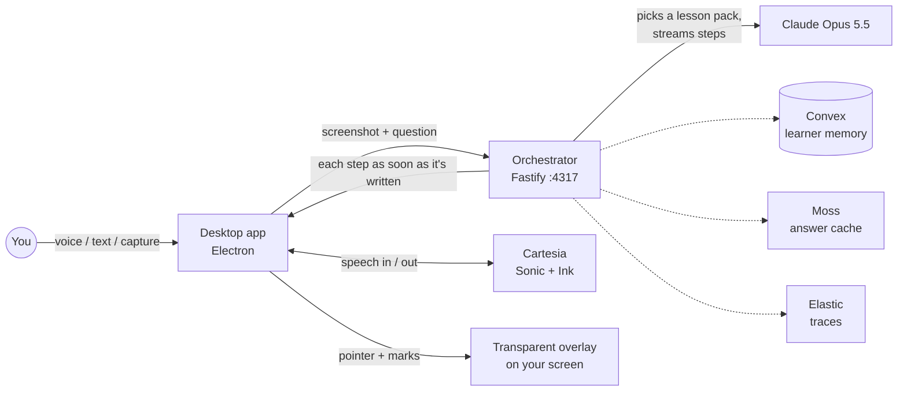

<p align="center">
  
</p>

<h1 align="center">Quicky.AI</h1>

<p align="center"><b>A tutor that sits on your screen, points at what matters, draws on it, and talks you through it.</b></p>

<p align="center">
  Windows · macOS · Electron + React + TypeScript · Claude Opus 5.5 · Cartesia voice · Built at Cal Hacks 13.0
</p>

---

## What it does

Put anything on your screen — a math problem, a chess position, an app you're stuck in, a page in another language — and ask Quicky.AI about it by voice or text. It looks at your screen and teaches you **right there**:

- 🔵 **Points** at each thing as it talks about it, with a small cursor that never covers what it points at
- ✍️ **Draws** hand-drawn marks on your screen — loops, arrows, boxes, underlines, keyboard shortcuts, word meanings — and **writes the working** beside the problem in handwriting. The working boards are laid out automatically in blank space (found by sampling the screenshot), so they never cover the diagram or each other
- 🔊 **Speaks** each step, and the pointer and drawings move exactly with the voice
- 🧭 **Stays with you** when you're *doing* something: for an app task or a chess game it guides one action at a time, watches your screen, checks what you did, and continues

The voice starts about **3 seconds** after you ask, while the rest of the answer is still being written.

### What you can learn

| Subject | Ask something like | What Quicky.AI does |
|---|---|---|
| **Math** | "Find x in this triangle." | Marks the sides and angles on your diagram, writes each line of working beside it, checks the answer |
| **Chess** | "Teach me the trick in this position, then guide me through it move by move." | Reads the board (either orientation), names the pattern, draws move arrows and boxes squares, then waits for each of your moves |
| **Software** | "How do I crop this photo?" | Points at the exact tool, shows the shortcut as keycaps, waits for your click, then guides the next step |
| **Languages** | "What does 飲みます mean?" | Writes the meaning and pronunciation under the word and explains the grammar |
| **Anything else** | "Explain this chart." | Points and marks while it explains |

The subject is detected automatically from your screen and question.

### How much it explains

Answers are **short and clear by default** (usually 4–8 steps). Ask for more and it becomes a patient, in-depth lesson: *"explain in detail"*, *"explain why"*, *"I don't understand"*, *"go slower"*.

---

## Try it

1. Start the app (see [Getting started](#getting-started)).
2. Put a problem on screen and ask — by voice, by typing, or by capturing just the area you care about (see the shortcuts below), or from the floating launcher's menu (**Voice · Capture · Text · Canvas**).
3. Watch and listen. The chat panel steps aside while it explains and comes back when it's done; the marks fade away a few seconds later. Press **Esc** to stop at any time.

### Keyboard shortcuts

| Shortcut (Cmd on Mac) | Action |
|---|---|
| **Ctrl+Alt+1** | Voice — ask out loud |
| **Ctrl+Alt+2** | Capture — select the area of the screen to ask about |
| **Ctrl+Alt+3** | Text — type a question |
| **Hold Ctrl+Shift+E** | Hold to talk, release to ask |
| **Esc** (or **Ctrl+Alt+0**) | Stop listening or teaching |

### Voice input

While you speak, your words appear live in the chat; Quicky.AI sends the question by itself after a short pause, and teaching starts as soon as the first step is ready. Speech recognition uses Cartesia Ink, and falls back to the system's speech recognition if Cartesia isn't available (for example, when its credits run out).

> **Demo Voice mode is currently ON.** For the hackathon demo, Voice skips the microphone: it shows "Listening…" for 3 seconds and then asks *"Explain me the problem on the screen."* Everything after that is real — the screenshot, Claude, the voice and the drawings — so it teaches whatever is actually on your screen. To use your own spoken questions, set `DEMO_VOICE_MODE = false` in [`packages/shared/src/demo-voice.ts`](packages/shared/src/demo-voice.ts).

### Chess demo — Philidor's smothered mate

Open [this position on Lichess](https://lichess.org/editor/4r2k/pp4pp/8/q5N1/2Q5/B7/PP3PPP/6K1_w_-_-_0_1) → **Continue from here** → **Play with the computer** (as White), then ask (type it with **Text** while Demo Voice mode is on):

> "Teach me the trick in this position so I can spot it in my own games, then guide me through it move by move."

Quicky.AI names the pattern, gives you a checklist for spotting it, and guides **Nf7+ → Nh6+ → Qg8+!! → Nf7#**, checking each of your moves and explaining Black's forced replies.

### Guided lessons

When a turn ends with something for you to do, a **"Your turn"** hint appears and the marks stay on screen. Then just do it — Quicky.AI notices your screen change and continues. You can also:

- say **"done"** or **"next"** (hold-to-talk; not while Demo Voice mode is on), or
- open the chat panel and press **Next step** / **End lesson**.

---

## How it works



1. **Ask.** The app takes a fresh screenshot of your screen (or the area you selected) and sends it with your question.
2. **Teach.** Claude follows the lesson pack for the subject (math, software, chess, language, general) and writes the answer as **steps**. Each step has what to say and what to draw — pointer positions and marks like `[DRAW:arrow:…]`, `[DRAW:work:…]`, `[DRAW:key:…:Ctrl+J]`, `[DRAW:gloss:…:word|meaning]`, or chess squares by name (`[DRAW:move:g1-f3]`) that the server turns into exact board positions.
3. **Stream.** Each finished step goes to the app immediately, so narration starts on step 1.
4. **Narrate.** Each step is spoken with Cartesia, and **the voice is the clock**: the pointer and marks for a step appear the moment that step's audio starts, so they never drift apart.
5. **Guide.** If the step asks you to do something, the app keeps the marks up, watches the screen for your change, and sends a new screenshot with the lesson so far. Claude checks what you did and continues.

More detail: [docs/architecture.md](docs/architecture.md).

### Built with

| Technology | Role |
|---|---|
| **Anthropic Claude Opus 5.5** | Reads the screen and writes the lesson (structured output, prompt caching, fast mode) |
| **Cartesia** | Sonic text-to-speech for the narration, Ink speech-to-text for voice questions |
| **Convex** | Learner memory and session history *(optional)* |
| **Moss** | Semantic cache for reworded questions about the same screen *(optional)* |
| **Elastic** | OpenTelemetry traces *(optional)* |

The **Core Services** panel (the status button in the chat panel's toolbar) shows which of these are connected right now — it only reports a service as live when its connection is actually verified.

Details: [docs/sponsor-integrations.md](docs/sponsor-integrations.md).

---

## Getting started

### Requirements

- **Node.js** 20.19 or newer (22+ recommended)
- **pnpm** 9 or newer
- An **Anthropic API key** (required) and a **Cartesia API key** with credits (for voice)

### Install

```bash
git clone https://github.com/Shibin506/Shibin-portfolio.git
cd Shibin-portfolio/quicky-ai
pnpm install
cp .env.example .env
```

Add your keys to the `.env` in the **repository root**:

```bash
ANTHROPIC_API_KEY=...
CARTESIA_API_KEY=...
CARTESIA_VOICE_ID=...
```

### Run

```bash
pnpm dev
```

This starts the orchestrator on port **4317** and the desktop app. Check the server with `curl http://localhost:4317/health`.

> **Windows (PowerShell):** use `pnpm.cmd` if script execution is disabled. If you see `Error: Electron uninstall`, run Electron's installer once:
> `node node_modules/.pnpm/electron@42.4.1_supports-color@8.1.1/node_modules/electron/install.js`

> **macOS:** grant **Screen Recording** (and Microphone, for voice) to Electron in System Settings → Privacy & Security, then relaunch.

### Configuration

| Variable | Default | Purpose |
|---|---|---|
| `ANTHROPIC_API_KEY` | — | **Required.** Claude |
| `CLAUDE_MODEL` | `claude-opus-5-5` | Model for teaching |
| `CLAUDE_SPEED` | `fast` | Opus fast mode; `standard` is cheaper |
| `CLAUDE_EFFORT` | `low` | Reasoning effort |
| `CARTESIA_API_KEY`, `CARTESIA_VOICE_ID` | — | Voice; without them the system voice is used |
| `CARTESIA_TTS_MODEL` / `CARTESIA_STT_MODEL` | `sonic-3.6` / `ink-2` | Voice models |
| `CONVEX_URL`, `SCREENTUTOR_CONVEX_SECRET` | — | Persistent learner memory (otherwise in-memory) |
| `MOSS_PROJECT_ID`, `MOSS_PROJECT_KEY` | — | Semantic answer cache |
| `ELASTIC_OTLP_ENDPOINT`, `ELASTIC_API_KEY` | — | Traces |
| `ORCHESTRATOR_PORT` | `4317` | API port |

Restart `pnpm dev` after editing `.env`.

---

## Accuracy tests

Quicky.AI has an accuracy test set: **13 generated screenshots** where the correct targets are known exactly — math diagrams, a photo editor, chess positions (both orientations, guided turns, the smothered-mate demo) and Spanish and Japanese text. Each case is a real Claude call scored on whether it picked the right subject, pointed at the right places, kept voice and drawings aligned, and knew when to guide versus explain.

```bash
pnpm --filter @screentutor/orchestrator eval            # all cases
pnpm --filter @screentutor/orchestrator eval -- chess   # only matching cases
```

Latest run: **13/13** subjects, **13/13** guided-or-explained correctly, voice and drawings aligned in every case, 95% of targets hit. See [services/orchestrator/evals](services/orchestrator/evals/README.md).

---

## Development

| Command | What it does |
|---|---|
| `pnpm dev` | Orchestrator + desktop app with hot reload |
| `pnpm dev:orchestrator` / `pnpm dev:desktop` | Run one side only |
| `pnpm test` | Unit tests (Vitest, 382 tests) |
| `pnpm typecheck` | Type-check every package |
| `pnpm build` | Production build |
| `pnpm dist:win` / `pnpm dist:mac` | Package an installer (unsigned) |

CI runs typecheck, tests and build on Windows and macOS ([ci.yml](.github/workflows/ci.yml)).

```
apps/desktop/            Electron app: launcher, chat panel, overlay, screen capture and watching
  src/main/              Windows, capture, screen watcher, permissions, hotkeys
  src/renderer/          React UI, voice (Cartesia), hand-drawn overlay renderer
services/orchestrator/   Fastify API on :4317
  src/prompts/           Core teaching prompt + subject lesson packs
  src/providers/         Claude call, streamed steps
  evals/                 Accuracy test set (fixtures, runner, scoring)
packages/shared/         Schemas, tag parser, chess board mapping, narration sync
docs/                    Architecture, privacy, sponsor notes
```

Internal package names still use the original `@screentutor/*` prefix; that is intentional.

---

## Privacy

- The screen is captured only when you ask a question — or, during a guided lesson you started, watched with small low-resolution captures to notice your next action.
- Sensitive windows (password managers, banking, and others on the denylist) are never captured, and privacy mode blocks analysis entirely.
- Screenshots are not stored; secrets, emails and card numbers are redacted from logs and traces.

More: [docs/privacy-and-safety.md](docs/privacy-and-safety.md).

---

## Troubleshooting

| Problem | Fix |
|---|---|
| Voice always asks "Explain me the problem on the screen." | Demo Voice mode is on — set `DEMO_VOICE_MODE = false` in `packages/shared/src/demo-voice.ts` |
| The explanation stops partway, or there is no voice | Your Cartesia credits may be used up (Cartesia returns `402 quota_exceeded`). Top up or use another `CARTESIA_API_KEY`, then restart |
| `ANTHROPIC_API_KEY is missing` | Create the root `.env` from `.env.example` and add the key |
| `Error: Electron uninstall` | Run Electron's `install.js` (see [Run](#run)) |
| `listen EADDRINUSE :4317` | The app is already running somewhere; stop it or set `ORCHESTRATOR_PORT` |
| Hold-to-talk hotkey doesn't work on macOS | Set `SCREENTUTOR_HOTKEY_MODE=toggle` in `.env` |
| Black or empty screenshots on macOS | Grant Screen Recording to Electron, then quit and relaunch |
| A guided lesson doesn't notice your move | Say "done" (hold-to-talk) or press **Next step** in the chat panel |

---

## Team

Built at Cal Hacks 13.0 by **Pratham Gala**, **Manav Patel**, **Dev Mulchandani**, **Jay Vithlani** and **Shibin Biji Thomas**.

Original repository: [pgala3183/CalHacks13.0](https://github.com/pgala3183/CalHacks13.0). This copy is kept in [Shibin's portfolio](https://github.com/Shibin506/Shibin-portfolio) as a record of Shibin's work on the team.
