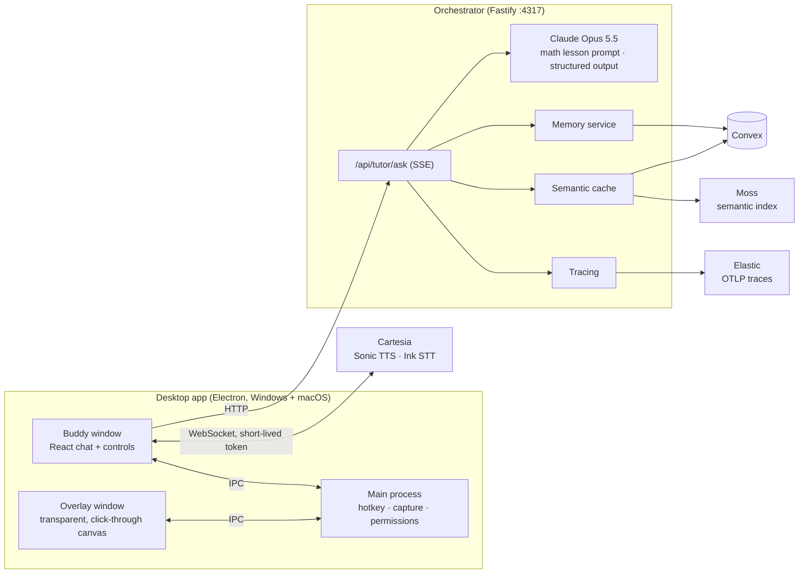
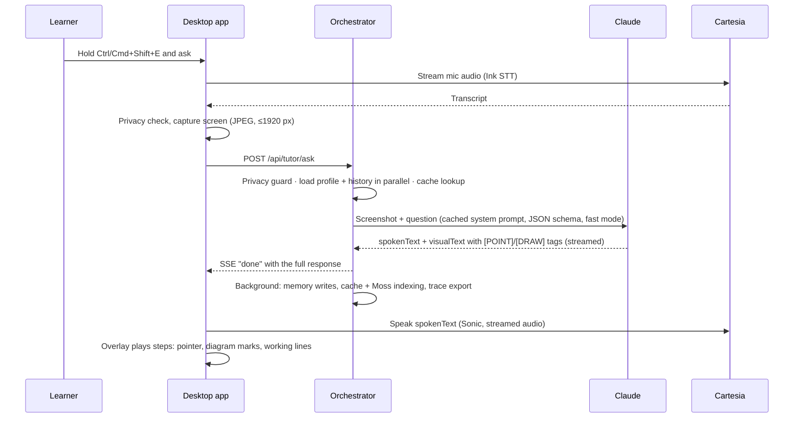

# Architecture — Quicky.AI

Quicky.AI explains and solves math problems on your screen. It is a pnpm monorepo with three parts:

| Part | Path | Language | Role |
|---|---|---|---|
| Desktop app | `apps/desktop` | TypeScript, Electron + React | Hotkeys, screen capture, the Buddy window, the transparent drawing overlay, voice in/out |
| Orchestrator | `services/orchestrator` | TypeScript, Fastify | Calls Claude with the math lesson prompt, learner memory, response cache, tracing |
| Shared library | `packages/shared` | TypeScript | Zod schemas, tag parsing, coordinate math, redaction |

Convex functions for learner memory live in `services/orchestrator/convex`.

## System overview

## A tutoring turn

## Drawing protocol

Claude writes two aligned texts: `spokenText` (for the voice) and `visualText` (one step per line, with tags). Coordinates are 0–1 fractions of the screenshot.

| Tag | Meaning |
|---|---|
| `[POINT:x,y:label]` | Move the pointer to an element |
| `[DRAW:clear]` | Start a new step |
| `[DRAW:circle:cx,cy,r]` · `[DRAW:arrow:x1,y1,x2,y2]` · `[DRAW:underline:…]` · `[DRAW:rightangle:x,y,size]` · `[DRAW:rect/highlight:x,y,w,h]` | Marks on the diagram |
| `[DRAW:work:x,y:text]` | A written line of working in blank space; stays for the whole explanation |

`packages/shared` parses and sanitizes the tags (`stream-tag-parser.ts`, `overlay-refine.ts`, `draw-shape-sanitize.ts`), and the overlay renders them on a canvas (`AnnotationOverlay.tsx`, `overlay-canvas.ts`). Earlier steps' marks stay on screen, dimmed.

## Platform layer

The Electron main process picks a backend per OS (`apps/desktop/src/main/platform.ts`):

| Feature | Windows | macOS |
|---|---|---|
| Hold-to-talk polling | `hold-key-poll.win32.ts` (user32) | `hold-key-poll.darwin.ts` (CoreGraphics) |
| Permissions | none needed | Screen Recording and Microphone (`permissions.ts`) |
| Hotkey | Ctrl+Shift+E | Cmd+Shift+E |

## Adding a subject later

Every request goes through one lesson prompt today, `MATH_LESSON_PROMPT` in `services/orchestrator/src/prompts/tutor-system-prompt.ts`, appended after the shared base prompt that defines the drawing protocol. A new subject means a new lesson prompt and a way to choose it (the request's `mode` field is the extension point); the capture, drawing, voice, memory and cache layers are subject-independent.

## Fallbacks

Every external service has a local fallback, so the app still runs when a key is missing:

| Service | Fallback |
|---|---|
| Convex | In-process memory |
| Moss | Exact-match cache only |
| Elastic | No-op tracing |
| Cartesia | System voice and browser speech recognition |

Claude itself is required.

## Privacy

See [privacy-and-safety.md](privacy-and-safety.md). In short: capture only on explicit action, a window-title denylist, privacy mode, redaction before any log/trace/error report, and screenshots never stored (only an MD5 hash).
