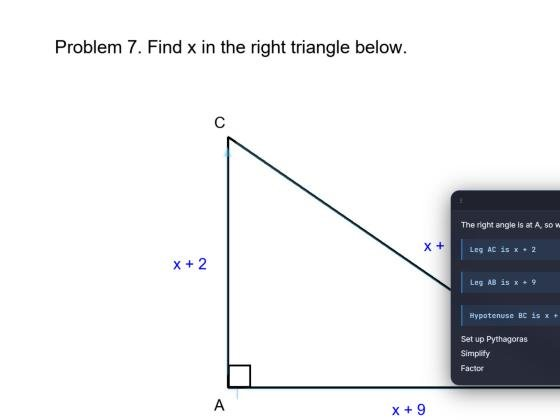

# Quicky.AI Fix Plan

> **Brand (Oct 24, 2026):** Product display name is **Quicky.AI** (formerly ScreenTutor / Quicke.AI in drafts).
>
> **Scope update (Oct 24, 2026):** Quicky.AI now focuses only on explaining and solving math problems. The tutor modes (hint, mistake, quiz, review, research, Co-drive), the Fetch.ai agent and Apify were removed, so items below that depend on them (for example the Fetch.ai "concepts due today" and Co-drive input) no longer apply. Issue 4 was delivered as a cross-platform Electron app rather than a Tauri port.

Diagnostics for the four issues found in testing, the fix for each, and how four teammates can work on them at the same time without stepping on each other's files.

Repo state: `main` @ `6cfae8d` · Diagnostics run Oct 23, 2026 · Cal Hacks 13.0

## Summary

| # | Issue | Root cause | Status |
|---|---|---|---|
| 1 | Voice and pointer/written explanation drift apart | Steps are timed from a character-count estimate, never from the audio. Measured drift reaches **8.9 s** by step 10 and grows every step. | Root cause found |
| 2 | Drawn shapes aren't visible | They are drawn (verified by reading canvas pixels) but sit exactly on the diagram's own lines in thin blue, fade to 35% (the right-angle mark to ~2%), and the explanation card covers them. | Root cause found |
| 3 | Make learning feel better and more engaging | The flow is one-way: the tutor talks, the learner watches. No pause, no "your turn", no sense of progress. | Design proposal |
| 4 | Run on Mac and Windows without Electron | Two Windows-only native modules, a privacy check that reads the wrong window, and unhandled macOS permissions. Recommended target: Tauri 2. | Migration plan |

## Diagnostics

### 1 · Voice vs. pointer timing (up to 8.9 s off)

**Test:** the 10-step narration for the right-triangle benchmark problem was synthesized with our Cartesia voice (`sonic-3.6`), and each step's real start time was compared with the time the app schedules it. The app splits a guessed total of 72 ms per character across steps by length (`packages/shared/src/narration-steps.ts`). Real speech ran **36.6 s** against a **30.5 s** guess, and short sentences carry long pauses the guess ignores.

| Step | App schedules (s) | Voice reaches (s) | Drift (s) |
|---|---:|---:|---:|
| 1. Right angle at A | 0.0 | 0.0 | 0.0 |
| 2. Leg AC is x + 2 | 4.3 | 3.8 | +0.6 |
| 3. Leg AB is x + 9 | 5.8 | 6.7 | −0.9 |
| 4. Hypotenuse BC is x + 10 | 7.3 | 9.4 | −2.2 |
| 5. Set up Pythagoras | 9.6 | 12.8 | −3.2 |
| 6. Expand each square | 15.7 | 19.9 | −4.2 |
| 7. Simplify | 17.1 | 21.7 | −4.5 |
| 8. Factor | 20.7 | 26.6 | −5.8 |
| 9. Lengths positive, x = 3 | 23.8 | 31.9 | −8.1 |
| 10. Check 5² + 12² = 13² | 26.8 | 35.7 | −8.9 |

- The overlay and the chat reveal also start the moment the answer arrives, before the voice socket has produced audio, which adds a further fixed lead.
- Muted mode and the system-voice fallback use the same estimate, so they drift too.

> **Fix:** drive steps from the audio clock. Ask Cartesia for word timestamps (`add_timestamps`) or send one transcript chunk per step in the same context, and advance the overlay when step *n*'s first word actually plays. Start the visuals on the first audio chunk, not on response arrival.

### 2 · Invisible shapes (drawn but not seen)



*Built overlay page replayed with real tutor output. The arrows along AC, AB and BC are there but sit on the black sides; the card covers the hypotenuse and the working column.*

- **Rendering works.** Canvas pixels read back at full opacity for the current step's arrow (alpha 255) and at 36% for earlier ones (alpha 92). The working lines render.
- **Marks sit on top of the diagram.** The prompt tells Claude to trace sides exactly, so a 3 px blue stroke lands on a black line and disappears.
- **Fading is too strong.** Earlier marks drop to 35%; the right-angle mark measured alpha 5/255, effectively invisible.
- **The explanation card covers the drawing area.** It anchors near the pointer, which is on the diagram.
- **Timing hides the rest.** Because of issue 1, each mark gets its full-strength moment while the voice is talking about something else.
- **Not yet checked on real hardware:** display scaling (125–150%) and second monitors. The overlay maps 0–1 coordinates to the display under the cursor; this needs one pass with `DEBUG_COORDINATES=true`.

> **Fix:** draw marks offset just outside the line they describe, thicker, in a high-contrast color with a dark halo; put the value as a chip beside the side; keep earlier marks at about 60%; place the explanation card in free space away from every mark and the working column.

### 3 · Engagement design (proposal)

Right now the learner watches a finished explanation. These additions turn it into a conversation, ordered by impact for the demo:

| Priority | Feature | Why it helps | Built on |
|---|---|---|---|
| P0 | **Your-turn checkpoints**: before the key line, the tutor stops and asks the learner to predict it ("What does (x+2)² expand to?"); they answer by voice or typing, Claude checks, then it continues | Active recall makes the learner do the thinking; it is the biggest learning lever here | Cartesia Ink, Claude, new `checkpoint` field |
| P0 | **Step controls**: pause, replay step, next, and "wait, why?" (barge-in by voice) | The learner sets the pace instead of chasing the voice | Narration controller from issue 1 |
| P0 | **Warm tone and small wins**: encouraging phrasing, a short celebration on a correct checkpoint, a "You solved it" recap card | Makes progress felt, lowers anxiety about wrong answers | Prompt rules, overlay |
| P1 | **Skill map and streaks**: weak → strong concept rings, daily streak, "3 concepts due today" | Shows improvement over days, gives a reason to come back | Convex weak concepts, Fetch.ai planner |
| P1 | **One-question quiz after each explanation** with instant feedback | Confirms understanding; feeds the skill map | Existing quiz agent, `quizOutcomes` |
| P2 | **Notebook**: save recap cards to review later | Turns sessions into study material | Convex |

### 4 · Platform audit (Mac + Windows)

Electron itself runs on macOS. What ties the app to Windows is small and specific, which keeps the port manageable:

| Area | Today | Problem | Tauri 2 replacement |
|---|---|---|---|
| Windows | Electron `BrowserWindow` (buddy + transparent overlay) | Large install, separate Chromium | Transparent, always-on-top, click-through webview windows (`set_ignore_cursor_events`); WebView2 on Windows, WKWebView on Mac |
| Hold-to-talk | `koffi` → `GetAsyncKeyState` polling | Windows only | `tauri-plugin-global-shortcut` pressed/released events |
| Co-drive input | `koffi` → `user32` mouse/keyboard | Windows only | `enigo` crate (Mac needs Accessibility permission) |
| Screen capture | `desktopCapturer` | Mac needs Screen Recording permission; not requested | `xcap` crate + `image` for resize/JPEG |
| Active window | First entry of the window capture list | **Bug on both OSes:** it isn't the focused window, so the privacy denylist can check the wrong title | `active-win-pos-rs` crate |
| Microphone | Chromium `getUserMedia` | Mac needs a usage string | Same web API; add `NSMicrophoneUsageDescription` |
| Renderer ↔ app | `window.electronAPI`: 24 IPC channels, 105-line preload | Electron-specific calls inside components | One `PlatformBridge` interface with Electron and Tauri implementations |

> **Hackathon risk:** a full port plus Mac signing is 1.5–2 days for one person. Keep the Electron build demo-ready until the Tauri build passes the go/no-go checklist below.

## Agree on these first (hour 0, about 45 minutes, all four)

These four interfaces are the only places where the workstreams touch. Merge them as one small PR before anyone starts; after that, everyone codes against the interface.

**Narration controller** — owner: Teammate 1 · used by 2 and 3

```ts
interface NarrationController {
  load(steps: NarrationStep[]): void;
  play(): void; pause(): void;
  replayStep(): void; next(): void;
  on(e: 'step', cb: (i: number) => void): void;
  on(e: 'end', cb: () => void): void;
}
```

**Overlay step signal** — owner: Teammate 1 · used by 2. The overlay only renders the step it's told to; it no longer keeps its own clock.

```ts
// main → overlay window; replaces the overlay's internal setTimeout schedule
'overlay-narration-step': { index: number }
```

**Response schema additions** — owner: Teammate 3 · reviewed by 1

```ts
checkpoint?: {
  afterStep: number;   // pause after this step
  question: string;    // asked aloud
  expected: string;    // for grading
}
```

**Platform bridge** — owner: Teammate 4 · used by everyone. New renderer code calls `platform.*`, never `window.electronAPI` directly.

```ts
// packages/platform: same methods as today's window.electronAPI, typed once.
export const platform: PlatformBridge;
// Electron impl now, Tauri impl later.
```

## Who does what

Each teammate owns a separate set of files, on its own branch. The one shared file, `AnnotationOverlay.tsx`, is split by responsibility: Teammate 1 owns step scheduling, Teammate 2 owns drawing and card placement, and Teammate 1's small change lands first.

### Teammate 1 · Issue 1 — Voice-synced narration

Branch `feature/narration-sync` · Files: `renderer/api/tts.ts`, `renderer/narration/*` (new), `shared/narration-steps.ts`, `App.tsx` narration effects, `main/index.ts` narration IPC, step scheduling in `AnnotationOverlay.tsx`

1. Build the `NarrationController` on the Web Audio clock; emit `step` when step *n*'s first word starts playing.
2. Request Cartesia word timestamps (or one chunk per step with `continue: true`) and map words to steps.
3. Replace the overlay's internal timers with the `overlay-narration-step` signal; start visuals on first audio.
4. Fallbacks: system voice via `onboundary` events; muted mode at the measured ~86 ms/char plus sentence pauses.
5. *Stretch:* stream finished steps from the server so step 1 starts ~3 s after asking instead of ~6.5 s.

**Done when** every step on the triangle benchmark starts within 250 ms of its voice, with a test that replays recorded timestamps.

### Teammate 2 · Issue 2 — Visible, readable drawings

Branch `feature/overlay-visuals` · Files: `renderer/components/overlay-canvas.ts`, `shared/draw-shape-sanitize.ts`, `shared/overlay-refine.ts`, `prompts/tutor-system-prompt.ts` (drawing rules), card placement in `AnnotationOverlay.tsx`

1. Restyle marks: high-contrast color with a dark halo, 5–6 px strokes, arrows offset ~12 px outside the side they describe.
2. Add value chips next to sides ("x + 2") and fix the right-angle mark's fade (measured alpha 5/255).
3. Keep earlier marks at ~60% instead of 35%.
4. Place the explanation card in free space that doesn't overlap any mark or the working column; make it collapsible.
5. Commit an overlay harness (`renderer/dev/overlay-harness.html`) that replays tutor output with a mocked platform API, for repeatable visual checks.
6. Verify on real hardware: 100/125/150% scaling, a second monitor, `DEBUG_COORDINATES=true`.

**Done when** on the triangle benchmark every mark is clearly visible at 1080p and 4K, and the card never covers a mark or working line.

### Teammate 3 · Issue 3 — Engaging learning flow

Branch `feature/engagement` · Files: `renderer/components/learning/*` (new), `convex/schema.ts` + `convex/progress.ts` (new), `shared/schemas/tutor.ts` (checkpoint), prompts (tone + checkpoint rules)

1. **P0** Your-turn checkpoints: prompt Claude to add one, pause narration there, take a voice or typed answer, grade it, continue.
2. **P0** Step controls UI (pause, replay, next, "wait, why?") wired to the narration controller.
3. **P0** Encouraging tone rules, celebration on a correct checkpoint, "You solved it" recap card.
4. **P1** Skill map and streak from Convex; "concepts due today" from the Fetch.ai planner.
5. **P1** One-question quiz after each explanation with instant feedback.

**Done when** a full triangle walkthrough includes one checkpoint the learner answers by voice, and the skill map updates afterwards.

### Teammate 4 · Issue 4 — Mac + Windows app (Tauri 2)

Branch `feature/tauri` · Files: `packages/platform/*` (new), `apps/tauri/*` (new: `src-tauri` Rust + Vite config reusing the renderer), `.github/workflows/desktop.yml` (new)

1. Hour 0: ship `PlatformBridge` with the Electron implementation so everyone else is unblocked.
2. Scaffold `apps/tauri` reusing the React renderer; buddy and overlay windows (transparent, always on top, click-through).
3. Rust commands: capture (`xcap`), active window (`active-win-pos-rs`, which also fixes the privacy bug), hold-to-talk (global shortcut pressed/released), Co-drive input (`enigo`).
4. macOS: request Screen Recording, Accessibility and Microphone permissions with clear in-app prompts; Info.plist usage strings.
5. CI builds on `windows-latest` and `macos-latest`; produce .msi and .dmg.

**Done when** the go/no-go checklist passes on one Mac and one Windows PC: capture, hold-to-talk, voice, overlay drawing, and Co-drive click.

## Order of work

| When | Milestone | What happens |
|---|---|---|
| Hour 0–1 | Contracts PR | All four agree and merge the four interfaces above. Teammate 4 ships the Electron `PlatformBridge`. |
| Hours 1–8 | Parallel build | Each teammate works on their own branch. Teammate 1 merges the overlay step signal early (first ~2 hours) because Teammates 2 and 3 build on it. |
| Hour ~8 | Merge 1 and 2 | Narration sync and overlay visuals go into `main`; re-run the triangle benchmark and the overlay harness. |
| Hour ~14 | Merge 3 | Engagement features land on top of the controller. Record a demo run. |
| Hour ~18 | Tauri go/no-go | If the checklist passes on both OSes, Teammate 4 rebases on `main` and the demo moves to Tauri. If not, demo on Electron and keep Tauri as the "runs on Mac and Windows" roadmap slide. |
| Final 4 hours | Freeze | Bug fixes only. Each teammate owns their area during judging. |

## Working rules

- Stay inside your file list; if you need to change someone else's file, ask them or open a tiny PR against their branch.
- Rebase on `main` after each merge milestone; never force-push `main`.
- Keep `pnpm test` green (currently 172 passing; the 2 known point-tag-parser failures are pre-existing).
- Use the triangle problem as the shared benchmark for timing and visuals, so results are comparable.
- Secrets stay in `.env`; never paste keys into chat, issues or commits.
